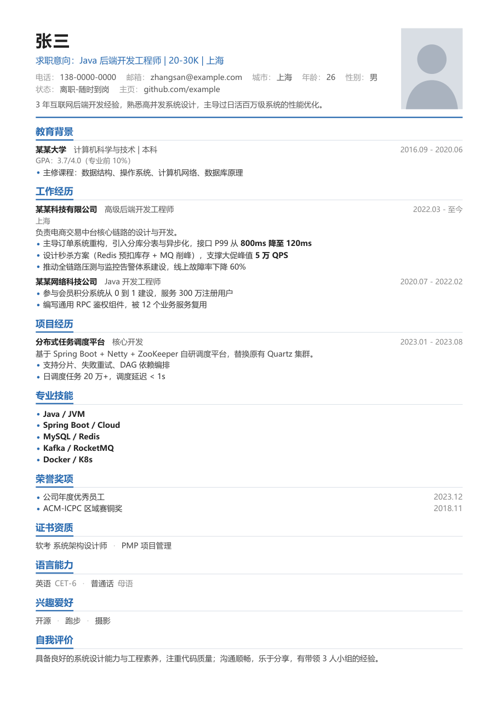
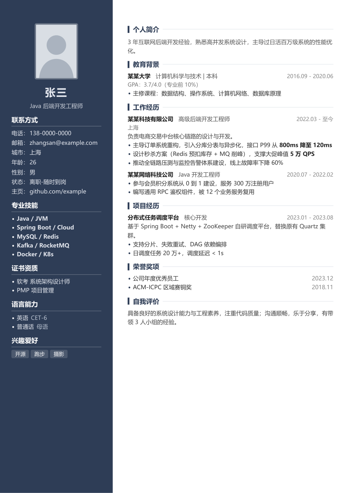
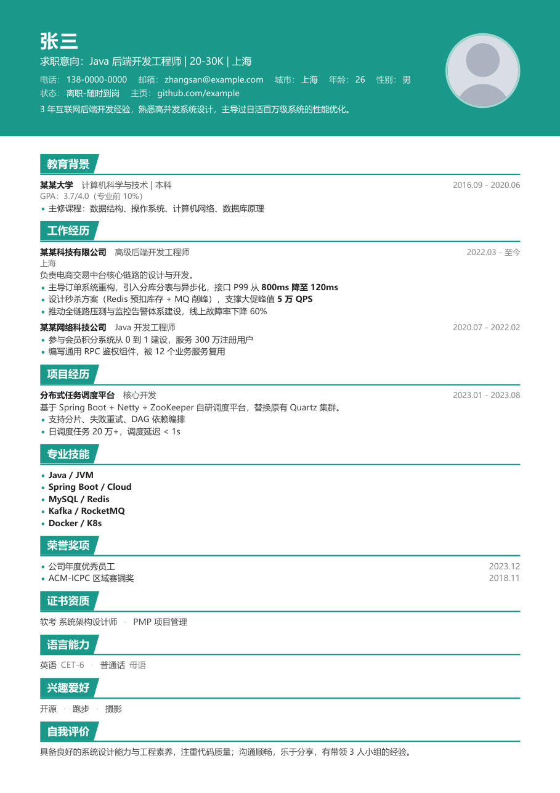
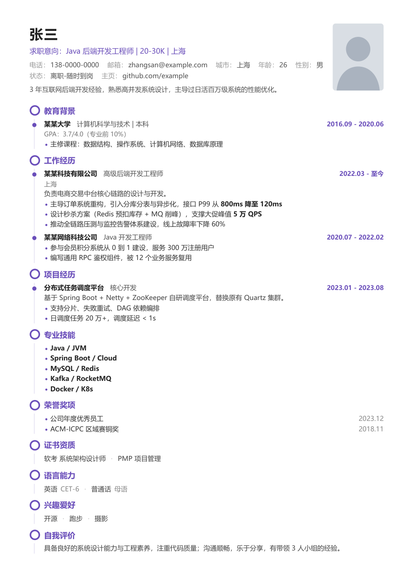
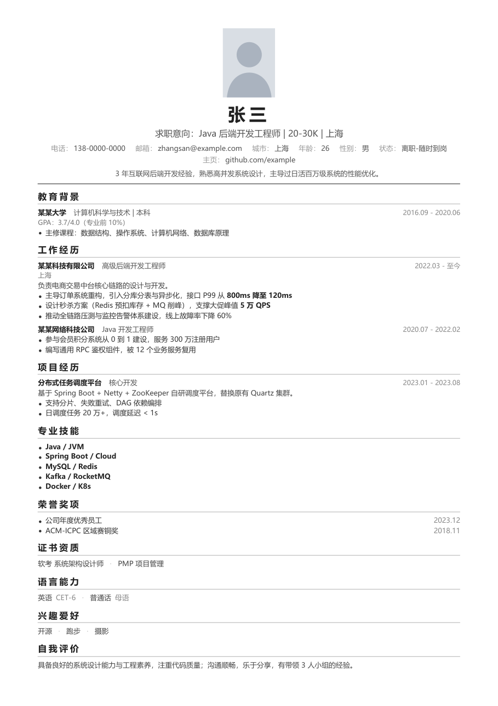
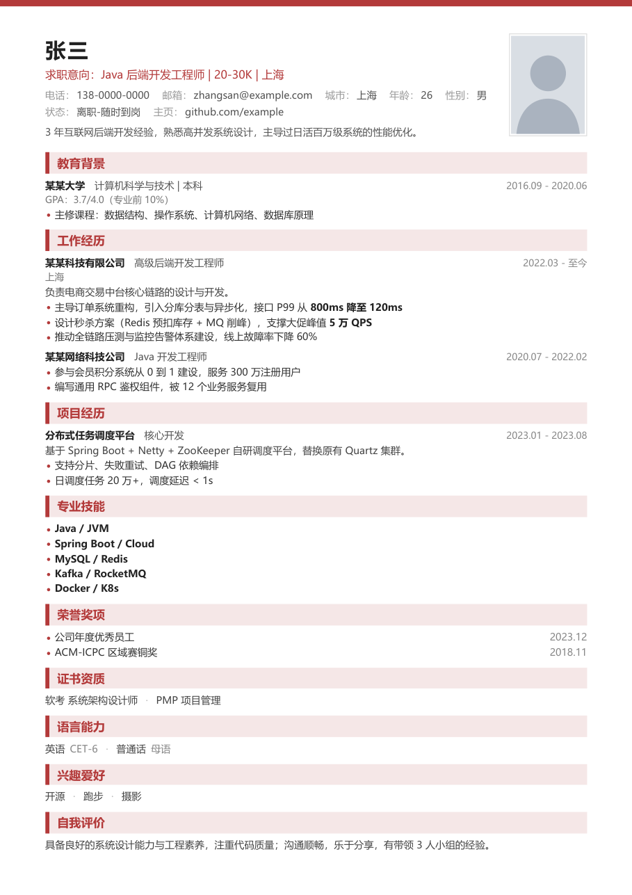
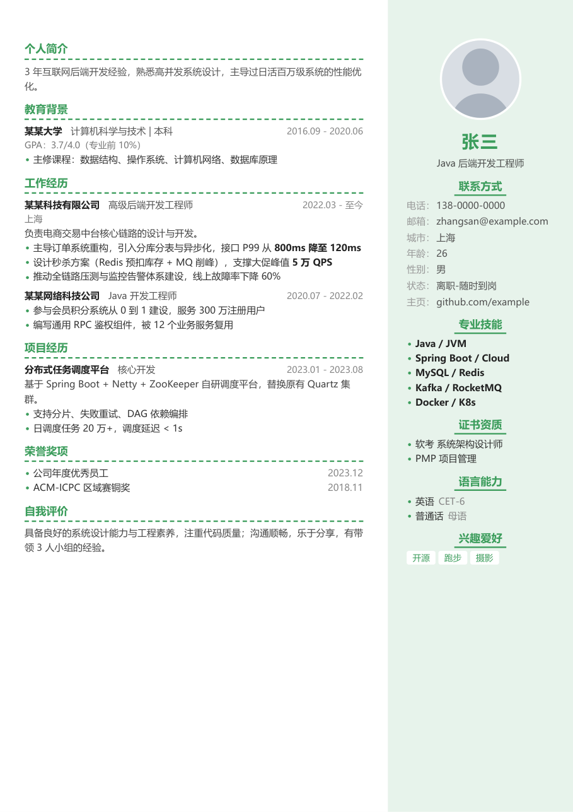
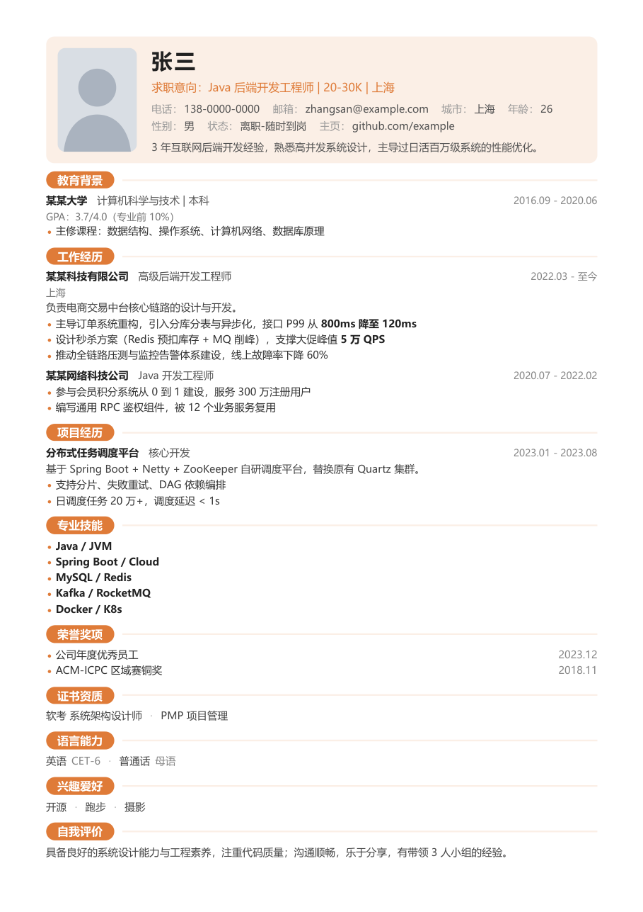

# resume-skills

中文简历生成工具：Claude Code Skill + MCP 服务。用自然语言描述经历，从 8 套模板中选一套，输出单文件 HTML 和一页 A4 PDF。

## 模板一览

| 经典蓝 `classic` | 深蓝侧栏 `sidebar` |
| :---: | :---: |
|  |  |
| 通用单栏，适合大多数岗位和应届生 | 深色侧栏双栏，信息密度高 |
| **青色横幅 `banner`** | **紫色时间轴 `timeline`** |
|  |  |
| 整块色彩头部，适合互联网、运营、市场 | 时间轴排布，突出成长路径 |
| **极简黑白 `minimal`** | **商务红 `business`** |
|  |  |
| 居中极简，适合金融、法律、咨询、外企 | 色条标题，适合销售、管理、传统行业 |
| **清新绿 `fresh`** | **活力橙 `modern`** |
|  |  |
| 浅色右侧栏，适合教育、设计、医疗 | 圆角标签标题，适合产品、新媒体、创意 |

截图使用 [示例数据](resume-builder/assets/sample.json) 生成，可以用 `node resume-builder/scripts/resume.mjs gallery --out _preview --pdf` 重新生成。

## 目录

- `resume-builder/`：Claude Code Skill（脚本只依赖 Node 18+，导出 PDF 需要 Chrome 或 Edge）
- `resume-mcp/`：MCP 服务（stdio），复用 resume-builder 的模板，两个目录需放在一起

## 安装 Skill

把 `resume-builder` 复制到 `~/.claude/skills/`（全局）或项目的 `.claude/skills/` 下。

## 配置 MCP

```bash
cd resume-mcp && npm install
claude mcp add resume -e RESUME_OUTPUT_DIR="D:/简历输出" -- node "D:/简历-skills/resume-mcp/server.mjs"
```

工具：`list_templates`、`get_resume_schema`、`render_resume`、`render_gallery`。
文件只会写到 `RESUME_OUTPUT_DIR` 内（默认是启动目录下的 `resume-output/`）。

测试：`node resume-mcp/test/smoke.mjs`
